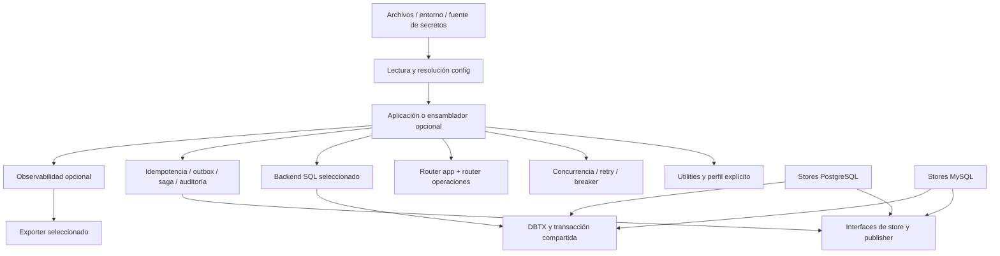

# Estrategia de modularización de go-engine

Estado: contratos de diseño definidos, previos a implementación y no APIs
publicadas. Inventario y revisión integral actualizados el 12 de noviembre de
2026. Las firmas/configuración normativas están en public-contracts y
concurrency-api; los ejemplos anteriores no prevalecen sobre esos documentos. **No continuar implementando ni publicar la nueva arquitectura hasta
cerrar el diseño completo.** El prototipo `concurrency/` y su cableado presentes
en el árbol de trabajo son experimentales: no constituyen la primera versión
aprobada ni cubren todavía todos los contratos de producción definidos aquí.
Los cambios anteriores se conservan para revisión; esta iteración modifica solo
documentación.

## Resultado esperado

Una aplicación puede importar solo configuración, solo utilidades, solo un
cliente de base de datos o un router, sin arrastrar el motor, otros drivers,
exportadores o funcionalidades no seleccionadas. Puede combinar herramientas
con configuración tipada y decorators. La aplicación o un ensamblador opcional
poseen los recursos y su ciclo de vida.

Un paquete Go separa código; un módulo con `go.mod` separa la unidad instalable.
Separar archivos dentro del mismo módulo no alcanza para independizar sus
requisitos. Tampoco es necesario crear un repositorio o release distinto por
cada herramienta. Se conserva el monorepo y tags por módulo con pruebas de consumidores fuera
del workspace. Los módulos existentes siguen coordinados en 0.x; concurrency
pasa a v1 solo con versión propia en manifiesto, después de cumplir sus gates.

## Documentos que completan la estrategia

| Documento | Decisiones que contiene |
|---|---|
| [Revisión integral](modularization/review.md) | Funcionalidades faltantes, acoplamientos, decisiones cerradas y pendientes con dueño |
| [Contratos públicos](modularization/public-contracts.md) | Superficie pública, tipos, configuración/defaults/validación, errores y ownership por módulo |
| [Índice de contratos](modularization/contract-index.md) | Cobertura explícita de todos los módulos del catálogo y sus integraciones |
| [API v1 de concurrencia](modularization/concurrency-api.md) | Firmas, Future, admisión, orden, weights, shutdown, alcance v1 y gates de estabilidad |
| [Inventario y destinos](modularization/inventory.md) | Los 69 directorios con código no-test; funcionalidad, destino y tratamiento de compatibilidad |
| [Configuración y construcción](modularization/configuration.md) | Lectura independiente, perfiles, secretos, tipos de backend, dominios/subdominios, validación y actualización |
| [Concurrencia y límites](modularization/concurrency.md) | Cancelación, admisión, errores, reintentos, IDs, orden por clave, recursos y límites de consistencia |
| [Composición y migración](modularization/composition-and-migration.md) | Decorators, orden de ejecución, transacciones, lifecycle, fases y criterios de aceptación |
| [Persistencia y operación](modularization/durable-and-operations.md) | Contratos detallados de idempotencia, outbox/inbox, sagas, auditoría, SQL, observabilidad y routers |

El inventario distingue extraer, dividir, adaptar, reemplazar y desarrollar.
No se considera existente una funcionalidad por aparecer en un README antiguo.
Por ejemplo, `pkg/config/dynamic`, `pkg/core/registry` y `file_utils` no existen
en el árbol revisado: no son fuentes de una migración automática.

## Catálogo objetivo de módulos

Todos los paths se entienden bajo `github.com/skolldire/go-engine/`.
Un destino anidado listado como módulo tendrá su propio `go.mod`. Los paquetes
internos de `utilities` no necesitan uno por cada helper.

| Módulo | Responsabilidad | Dependencias permitidas |
|---|---|---|
| `utilities` | Funciones puras: perfil, strings, colecciones, punteros y defaults | Biblioteca estándar; sin SDK, logger, configuración global ni I/O implícito |
| `config` | Snapshot, secciones, mezcla, resolución y decodificación estricta | Biblioteca estándar + decoder específico si es necesario; no conoce tipos de herramientas |
| `config/json`, `config/env` (paquetes del módulo config) | Fuentes JSON y bindings de entorno explícitos | Biblioteca estándar; no go.mod adicional |
| `config/yaml` | Fuente YAML independiente | `config` + parser YAML; no engine ni Viper obligatorio |
| `config/viper` | Puente opcional de migración del lector actual | `config` + Viper; no requerido por herramientas ni por YAML puro |
| `config/ssm` | Fuente/secretos SSM opcional | `config` + cliente SSM; ninguna dependencia AWS desde `config` |
| `concurrency` | Colas, pools, pipelines, lotes, fan-out/in, límites y serialización local por clave | Biblioteca estándar; hooks/interfaces del consumidor |
| `ratelimit` | Token bucket local; Wait/Allow y burst explícitos | Biblioteca estándar; no semáforo ni límite distribuido |
| `retry` | Política de reintentos, backoff exponencial acotado y jitter | Biblioteca estándar; no concurrencia ni logging obligatorios |
| `circuitbreaker` | Admisión closed/open/half-open y probes | Biblioteca estándar o dependencia exclusiva de breaker |
| `resilience` | Composición opcional de retry, breaker, deadlines y límites | Solo herramientas elegidas; sin engine |
| `logging` | Construcción de logger estructurado basado en slog y redacción | Biblioteca estándar; sin OTel/logrus obligatorios |
| `logging/logrus` | Compatibilidad opcional con logrus | Logging y logrus |
| `validation` | Reglas y validación de structs | Validator explícito; sin global mutable ni utilidad conglomerada |
| `client/logging`, `client/otel`, `client/resilience` | Decorators opcionales por integración | Cada wrapper importa solo su herramienta/SDK |
| `client` | Contratos mínimos de ejecución/middleware extraídos de BaseClient | Biblioteca estándar; observabilidad y resiliencia en paquetes de integración separados |
| `health` | Liveness/readiness, registro y evaluación acotada | Biblioteca estándar; checkers por interfaces pequeñas, sin drivers |
| `httpclient` | HTTP saliente estándar | Biblioteca estándar; no router |
| `httpclient/resty` | API y compatibilidad con resty opcionales | Cliente/adaptador resty; no exportar tipos resty desde `httpclient` |
| `router` | Router de aplicación, host routing, middleware y servidor opcional | HTTP estándar; configuración tipada propia |
| `router/chi` | Compatibilidad/implementación chi opcional | `router` y chi; conservar escape hatch nativo explícito |
| `router/errors` | Representación de errores HTTP y respuestas redactadas | HTTP estándar; sin clasificación universal de negocio |
| `router/operations` | Ping, salud, profiling y handler de métricas opcional | HTTP estándar + health; no exporter obligatorio |
| `auth/jwt/http` | Middleware HTTP sobre verifier neutral | Auth JWT + HTTP stdlib; no chi/engine |
| `auth/jwt` | JWT/JWKS, claims, issuer/audience y autorización por grupos | JWT/JWK; sin AWS, router o engine; adaptador HTTP en paquete separado |
| `telemetry/otel` | Instrumentación, resource, providers y shutdown explícito | OTel; no exportadores obligatorios |
| `telemetry/otlphttp`, `telemetry/otlpgrpc` | Exportadores independientes por transporte | OTel + transporte elegido; HTTP no importa gRPC |
| `telemetry/prometheus` | Exportación pull opcional | Solo exporter y dependencias necesarias |
| `telemetry/otellog` | Puente slog → OTel Logs opcional | Slog + SDK de logs; separado de traces/metrics |
| `database/atomic` | Pool `database/sql`, DBTX, transacciones y stats | Biblioteca estándar; sin driver, ORM o retry implícito |
| `database/postgres`, `database/mysql` | Conexión, DSN/TLS y capacidades por dialecto | Driver correspondiente + `database/atomic`; ninguno importa al otro |
| `database/gorm/postgres`, `database/gorm/mysql` | Dialectors GORM opt-in por motor | GORM + driver seleccionado |
| `database/gorm` | CRUD y transacciones GORM | GORM; dialector recibido o adaptador opcional por dialecto |
| `database/redis`, `database/mongodb`, `database/memcached` | Funciones actuales de cada store | Solo SDK propio; desacoplados de engine/BaseClient actual |
| `messaging/kafka`, `messaging/rabbitmq` | Producción/consumo, ack, DLQ y límites por transporte | SDK propio + políticas inyectadas; no importación cruzada |
| `rpc/grpc` | Cliente/servidor, TLS, metadata y shutdown gRPC | gRPC; no Kafka/RabbitMQ |
| `aws/config` | Credenciales, región y transporte AWS compartibles | SDK base/config AWS; credenciales no duplicadas por servicio |
| `aws/{s3,sqs,sns,ses,ssm,cognito,dynamodb,lambda}` | Cliente independiente por servicio | SDK base y SDK del servicio elegido; Cognito sigue siendo adaptación específica |
| `integration/cloud/logging`, `integration/cloud/otel` | Decorators de fachada separados | Fachada + logging/OTel elegidos |
| `integration/cloud` | Request/response/middleware de fachada opcional | Biblioteca estándar; revisar nombres heredados AWS sin imponerlos a clientes nativos |
| `integration/aws/<servicio>` | Adaptador de fachada por servicio | Contratos de fachada + SDK de ese servicio |
| `integration/aws` | Fachada de conveniencia que agrupa servicios | Agregador explícito; su footprint mayor es opt-in |
| `integration/aws/events` | Eventos API Gateway/SNS/SQS entrantes | SDK de eventos Lambda + contratos; no SDK saliente obligatorio |
| `idempotency`, `outbox`, `inbox`, `saga`, `audit` | Contratos, políticas y máquinas de estado durables | Interfaces del consumidor; no driver ni engine |
| `<capacidad>/postgres`, `<capacidad>/mysql` | Stores SQL de cada capacidad durable | Su contrato + dialecto/DBTX elegido; comparten la transacción del llamador |
| `engine` | Registro, lifecycle y composición opcional | Contratos mínimos; no todos los routers/adaptadores/SDK |
| `engine/providers/<herramienta>` | Lectura de sección y puente al constructor | Engine + herramienta concreta + config si decodifica raw |
| `presets/<selección>` | Composición de conveniencia | Dependencias declaradas visibles; nunca requerido por una herramienta |

Se crea un módulo al extraer o desarrollar funcionalidad real, no una colección
de módulos vacíos. El catálogo fija fronteras para evitar que una extracción
provisional introduzca dependencias que luego sea difícil retirar.

## Reglas de dependencia y composición

1. Cada herramienta declara su `Config` y valida sus invariantes. No lee YAML,
   variables de entorno ni secretos de forma implícita.
2. `config` entrega valores; no construye clientes ni importa los `Config` de
   todas las herramientas. `utilities` no importa `config` ni el motor.
3. La configuración selecciona entre adaptadores registrados explícitamente en
   la aplicación. Un string `type: postgres` no descarga ni carga drivers Go.
4. Los contratos se expresan con tipos Go y pequeñas interfaces propiedad del
   consumidor. No se crea un paquete universal `common` de dependencias.
5. Decorators agregan políticas. El constructor base sigue utilizable solo.
   Observadores no fuerzan SDK; el ensamblado conoce el orden de composición.
6. Transacciones y stores financieros usan la misma conexión/transacción cuando
   requieren atomicidad. La concurrencia local no ofrece exclusión entre réplicas.
7. Ninguna herramienta importa engine, presets o un agregador que reúna todos
   los backends. Los SDK no aparecen en contratos de módulos neutrales.
8. No se cambia el comportamiento de producción solamente por mover código:
   cambios semánticos necesitan contrato, migración y validación propios.

## Estado, prioridades y decisiones previas al código

El inventario y contratos forman la estrategia revisable; no son una promesa de
que todas las capacidades estén implementadas. Primero cerrar contratos y
compatibilidad, después extraer utilidades/config/logging y primitivas, luego
SQL y stores durables, y finalmente migrar adaptadores y ensamblado. La secuencia
y pruebas están en [composición y migración](modularization/composition-and-migration.md).

Decisiones de diseño fijadas: PostgreSQL y MySQL; configuración tipada local;
backend registration explícito; utilities sin SDK; decorators visibles;
serialización por clave solo local; cero descarte silencioso para trabajo
durable; OTLP por transporte; routers de app y operaciones separados; releases
coordinados en módulos actuales y v1 independiente para concurrency. Parámetros de negocio como retención, payloads máximos,
presupuestos, orden y política de admisión pertenecen a cada aplicación, con
validación y defaults documentados, no a valores financieros inventados.

Los contratos públicos y matrices de configuración/defaults quedan definidos
en los documentos normativos enlazados. Implementar exige probar esos contratos,
no volver a elegir entre alternativas omitidas. Los límites que pertenecen a
la aplicación se declaran requeridos, sin defaults financieros inventados. Los mínimos de versiones de
PostgreSQL/MySQL, esquema de release y versión de ruptura deben publicarse al
preparar esa implementación; este diseño no los supone implícitamente.
